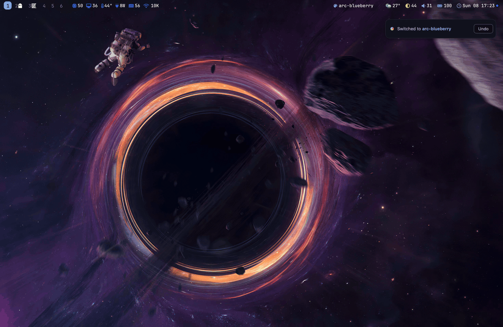
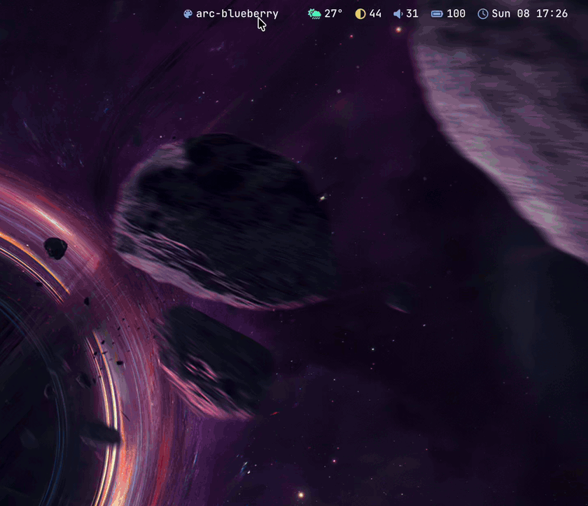
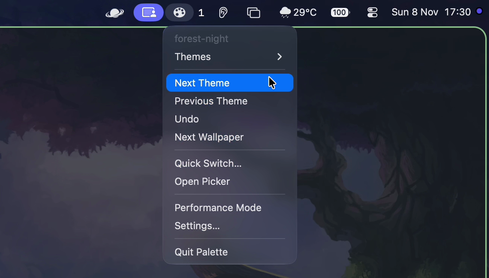
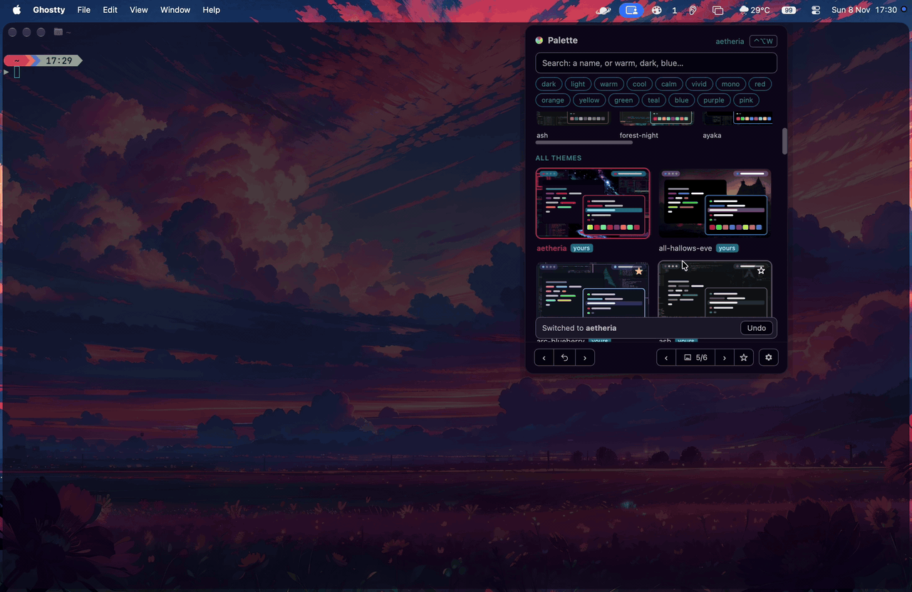

# Palette

One click, one hotkey or one command restyles your whole Mac desktop from a single palette file.



Palette is an open-source, Omarchy-style theme switcher for macOS. Pick a theme and your
bar, window borders, terminals, editors, command-line tools, wallpaper and light or dark
mode all change together. It has a menu bar app and a `palette` command-line tool, and
both do everything: you never need the terminal, and you never need the app. Themes are
plain `colors.toml` files, and Omarchy's community themes work as they are.

- **Fast to switch:** a quick switcher on a global hotkey, a menu bar picker, the bar's
  theme pill, or `palette set nord`. Undo steps back.
- **Readable by default:** Palette checks every theme's colours and quietly fixes the ones
  that are hard to read (a selection the shade of the background, faint comments), in
  lightness only, so the theme still looks like itself.
- **Safe with your configs:** it adds one import line to each app's config, backed up
  first, and can take it out again. Nothing else in your files is rewritten.
- **Private and light:** no account, no telemetry, no background service; network only
  when you ask it to download something. About 65 MB at rest.

macOS only for now (Apple silicon). Linux support is being worked on.

## What it themes

22 apps and parts of the desktop. `palette doctor` shows which ones are installed and
wired on your Mac; switch any of them off with `palette apps off <name>` or in Settings → Apps.

| | |
|---|---|
| **Desktop** | SketchyBar (bar colours, plus a theme pill you can click or scroll), JankyBorders, the wallpaper, macOS light or dark mode |
| **Terminals** | Ghostty, kitty, Alacritty, WezTerm, tmux |
| **Editors** | VSCodium, Zed, Neovim, Obsidian |
| **Command-line tools** | Starship (merged with your own `starship.toml`), btop, fzf, bat, lazygit, and a small shell file that loads their colours in new terminals |
| **Apps** | Habit Tracker, Chess Review, Dispatch, EasyPlots (each follows its own colours file) |

Optional, if you let it: the bar's layout, AeroSpace gaps and shortcuts, border width and
glow, your Starship prompt, and the Dock and menu bar (see *Desktop pages* below).

23 themes come with Palette, and 112 community themes are one click away.

## Install

```sh
brew install --cask praddy-31/tap/palette
```

This installs Palette.app and the `palette` command.

### From the DMG

1. Download `Palette-<version>-arm64.dmg` from
   [GitHub Releases](https://github.com/praddy-31/Palette/releases), open it and drag
   Palette to Applications.
2. Before the first open, run this once in Terminal:

   ```sh
   xattr -dr com.apple.quarantine /Applications/Palette.app
   ```

   Palette is ad-hoc signed, not notarised (there is no paid Apple developer account
   behind it), so macOS blocks a downloaded copy with "Palette can't be opened" or
   "Palette is damaged". It isn't damaged: the command removes the download flag macOS
   puts on files from the internet. Instead of the command you can open Palette once,
   then go to System Settings → Privacy & Security and press **Open Anyway**.
3. For the `palette` command, open **Settings → General → Command-line tool**. It links
   `~/.local/bin/palette` to the copy inside the app (`~/.local/bin` must be on your
   `PATH`; it is on most setups).

Building from source needs Rust, Xcode Command Line Tools and the Tauri CLI
(`cargo install tauri-cli --version '^2'`); no Node. See [CONTRIBUTING.md](CONTRIBUTING.md).

## First run

Open Palette: a short tour shows the menu bar icon, the hotkey and what Palette changes,
then offers to wire your apps. From the terminal it's the same step:

```sh
palette init --dry-run    # show what would change, touch nothing
palette init
```

`palette init` adds one import line to each app's config so the app loads Palette's file.
Before it changes anything it backs up the config to `~/.config/palette/backup/<time>/`
(the last 5 are kept). `palette init --remove` takes Palette's lines back out, and
`palette doctor` checks that each app is installed, wired and up to date.

## Switching themes



- **Quick switcher.** A global hotkey (`alt+shift+t`, ⌥⇧T, by default; change it in
  Settings → General or with `palette hotkey <new hotkey>`) opens a list you drive with the keyboard: ↑↓ to choose,
  ←→ for the theme's wallpapers, ↩ to apply, and type to search.
- **Menu bar.** Choose what a click on the icon opens: a native menu (themes, favourites,
  next, wallpaper, Performance mode), the picker grid, or the quick switcher.

  
- **Theme cards.** The picker, the quick switcher and Settings draw each theme as a tiny
  desktop (bar, editor, terminal on its wallpaper), so you see it before you switch.
- **Search by look.** Type or click words such as `warm dark`, `light calm`, `mono` or a
  colour name (`purple`), in the app or with `palette list warm dark`.
- **Favourites and recents.** Star up to ten themes; `palette next` can step through only
  those, and scrolling on the bar's theme pill switches theme (`palette fav scroll on`).
- **Day and night.** Pick a light and a dark theme and a city; Palette switches at sunrise
  and sunset, with no location services and no network (`palette schedule`).
- **Command line.**

  ```sh
  palette list                  # swatches; * marks the active theme
  palette set tokyo-night       # switch (add --dry-run to preview)
  palette next                  # or: palette prev
  palette undo                  # back to the previous theme; repeat to go further
  palette recent                # the last themes you used
  ```

## Getting more themes

<!--  -->

Settings → Get themes lists Omarchy's community themes (offline, searchable by look);
**Install** downloads only a theme's colours, wallpapers and preview, never config files.

```sh
palette catalog warm          # the offline list, narrowed by look
palette install aura          # a name from the catalogue
palette install https://github.com/someone/their-theme
palette update                # download installed themes again
palette remove aura
palette catalog --sheet ~/Desktop/themes.html   # every catalogue theme on one offline page
```

`palette new my-theme --from-wallpaper photo.jpg` makes a whole theme from a picture.

## Wallpapers

<!--  -->

Each theme can have several wallpapers, and Settings → Wallpapers manages them.

```sh
palette bg list
palette bg next                                     # or: prev, set <name>, default <name>
palette bg add --theme nord ~/Pictures/*.jpg
palette bg generate waves --apply                   # paint one from the theme's colours
palette bg recolor photo.jpg --theme nord --apply   # remap a picture to the theme's colours
palette bg get <link>                               # one picture, or pick from a GitHub repo
palette bg library                                  # pictures for any theme
```

`generate` has six styles: gradient, mesh, waves, topo, geometric and grain. Generating
and recolouring work offline with no extra tools. See [docs/WALLPAPERS.md](docs/WALLPAPERS.md)
for the library, links and how recolouring works.

## Colours and readability

- **Readability fixes.** Off, Minimal or Strong (Settings → Colours, or
  `palette check --level strong`). Palette fixes hard-to-read colours when a theme is
  used, per app where it matters (an editor's selection, lazygit's selected line, text on
  a see-through terminal), and leaves any colour you set yourself alone. Keep a theme
  exactly as its author made it with `palette check <theme> --original on`.
- **Contrast report.** `palette check` lists every fix and any pair that is still low;
  `palette check --app` shows the verdict per app.
- **Your own colours.** Change any colour in Settings → Colours or with
  `palette colours --set accent=#7aa2f7`. Edits sit on top of the theme (`edits.toml`), so
  updates never overwrite them, and `palette colours --reset` brings the original back.
- **Monochrome themes** get evenly spaced greys and a faint tint of their hue, so terminal
  colours stay apart.

## Windows and glass



- **Window glass.** Ghostty, kitty, Alacritty, WezTerm, Dispatch, EasyPlots and the Habit
  Tracker can be solid, blurred or clear at the strength you pick (Ghostty also has macOS 26's
  own glass). Zed gets its own see-through theme. Settings → Apps, or the same words in the
  terminal: `palette glass ghostty clear --strength 20`, `palette zed blurred --strength 40`.
  By default Palette leaves each terminal's own setting alone (`palette glass ghostty own`).
- **Performance mode.** One click (menu bar, Settings, or `palette performance on`) makes
  every glass window solid and the bar and borders plainer, to spare the GPU and battery.
  Click again and every look comes back.

## Desktop pages (optional)

<!--  -->

Settings → Bar, Windows, Borders, Prompt and Dock & menu bar let Palette manage SketchyBar,
AeroSpace, JankyBorders and Starship for you: pills and where they sit, gaps, keyboard
shortcuts, border width and glow, prompt blocks. For the bar, windows and borders nothing
changes until you press **Let Palette manage**; your file is kept as the original, every
change is backed up first, and **Give it back** restores yours. The Prompt page edits only
the keys it shows in `starship.toml`; the Dock & menu bar page changes macOS settings, and
switching an option back undoes it. **Match the menu bar** sizes the bar, its pills and text to
your Mac's menu bar strip (`palette desktop bar fit`).

**The top gap on more than one display.** AeroSpace counts the top gap from the area macOS
lets windows use. On a MacBook screen with a notch, macOS always keeps the menu bar's strip
(even with the menu bar hidden), so windows start below it and your bar sits inside it. On an
external display or an iPad with the menu bar hidden there is no strip: windows can reach the
very top, behind your bar. So Settings → Windows → **Different top gap on other displays**
gives those displays their own gap, counted from the top edge. With **Match the MacBook
screen** (on by default) Palette sets it to your bar plus Top, so windows start the same
distance below the bar everywhere. With a 32 pt bar and Top 4:

| Display | AeroSpace counts from | Top gap | Windows start |
|---|---|---|---|
| MacBook screen (notch) | below the 32 pt menu bar strip | Top: 4 | 32 + 4 = 36 pt down, 4 below the bar |
| Other displays, menu bar hidden | the top edge of the screen | bar + Top: 32 + 4 = 36 | 36 pt down, 4 below the bar |

Palette works the number out again whenever you change the bar or Top; turn Match off to type
your own (`palette desktop windows set gaps.follow_bar=false gaps.outer_top_other=40`). From the terminal: `palette desktop`,
`palette desktop bar manage`, `palette desktop bar release`.

Settings → Get the tools shows which of SketchyBar, JankyBorders, AeroSpace and gowall are
installed, with the Homebrew command to copy (Palette never runs Homebrew), and can write a
small themed starter config for a tool that has none (`palette tools`).

## Moving to another Mac

`palette export <folder>` copies your themes, wallpapers, settings and (if you like) your
app configs into a plain folder; `palette import <folder>` on the other Mac sets it up,
backing up whatever it replaces (`--dry-run` shows what would change first). Add
`--library` to take your wallpaper library along too. Settings → Move to another Mac does
the same. Nothing leaves your Mac: you carry the folder yourself.

## Settings from the keyboard

Settings works without the mouse: 1-9 and 0 open the first ten tabs, W B J P D the desktop pages
(Windows, Bar, Borders, Prompt, Dock & menu bar) and H "Where things are"; ↑↓ move through the
tabs, from setting to setting, and through My themes (↩ uses a theme, F stars it), ←→ go between
the tab list and the page, Esc leaves a box, ⌘[ ⌘] step through tabs, / searches, and ? lists
every key. A strip at the bottom keeps
the main ones in view.

## Light on memory

The app's windows are web pages, so Settings → General → Windows chooses how long they
stay loaded. *Keep ready* opens everything at once. *Load on demand* builds the picker and
Settings when you open them and frees them a few seconds after they close. *Everything on
demand* frees the quick switcher too: about 65 MB at rest on an M4.
`palette ui --windows ready|on-demand|all-on-demand`.

## Safety

- **Import, don't overwrite.** Palette writes only inside `~/.config/palette/`. Your own
  configs get one marked import line, added by `palette init` and removed by
  `palette init --remove`. Nothing else in them is rewritten. The one exception is opt-in,
  per tool: after **Let Palette manage** on a desktop page, Palette writes that tool's
  config (sketchybarrc, bordersrc, aerospace.toml key by key), backing it up before every
  change; **Give it back** restores your original. The Prompt page edits the keys it shows
  in your `starship.toml`, the rest of the file stays as written.
- **Atomic switches.** Each switch renders into a new folder and repoints the `current`
  symlink in one step, so an app never reads a half-written file.
- **Themes are data.** Nothing in a theme folder is ever run. Files that could run
  programs (shell scripts, tmux, fzf, starship, lazygit, Lua) cannot be replaced by a
  theme. `palette install` takes only colours, wallpapers and a preview image.
- **Fake homes for testing.** Set `PALETTE_HOME` to any folder and Palette uses it
  instead of your real home, writing files only (no reloads, no system changes):

  ```sh
  PALETTE_HOME=./tmp/home palette set nord
  ```

- **Privacy.** No telemetry, no background service, no network access except when you
  explicitly run `palette install`, `palette update` or `palette bg get` (or press the same
  buttons in the app). The bar's weather pill fetches the weather only if you add it.
  `palette log` keeps a local log of switches only if you turn it on.

## Uninstall

1. If you used the desktop pages: **Give it back** on each one (or
   `palette desktop <tool> release`) to get your own configs back.
2. `palette init --remove` to take Palette's lines out of your configs.
3. Turn off Open at Login in Settings, then quit Palette from the menu bar.
4. `brew uninstall --cask praddy-31/tap/palette`, or drag Palette.app to the Bin and delete
   the `~/.local/bin/palette` link.
5. Optional: delete `~/.config/palette/` (themes, wallpapers, backups, settings).

## Guides

- [Making a theme](docs/THEME_AUTHORING.md)
- [Theme file reference](docs/THEME_SPEC.md)
- [Adding support for another app](docs/ADDING_A_TARGET.md)
- [How it is built](docs/ARCHITECTURE.md)
- [Wallpapers](docs/WALLPAPERS.md)
- [Contributing](CONTRIBUTING.md)

## Licence

MIT. See [LICENSE](LICENSE).

## Credits

Most bundled and catalogue colours come from [Omarchy](https://github.com/basecamp/omarchy)
(basecamp/omarchy, MIT), whose `colors.toml` format Palette follows. Thanks to the
authors of the Omarchy community themes.

The desktop Palette dresses up is other people's work, and Palette only writes their config
files:

- [SketchyBar](https://github.com/FelixKratz/SketchyBar) and
  [JankyBorders](https://github.com/FelixKratz/JankyBorders) by Felix Kratz
- [AeroSpace](https://github.com/nikitabobko/AeroSpace) by Nikita Bobko
- [Starship](https://github.com/starship/starship) by the Starship contributors
- [gowall](https://github.com/Achno/gowall) by Achno (optional recolouring engine)
